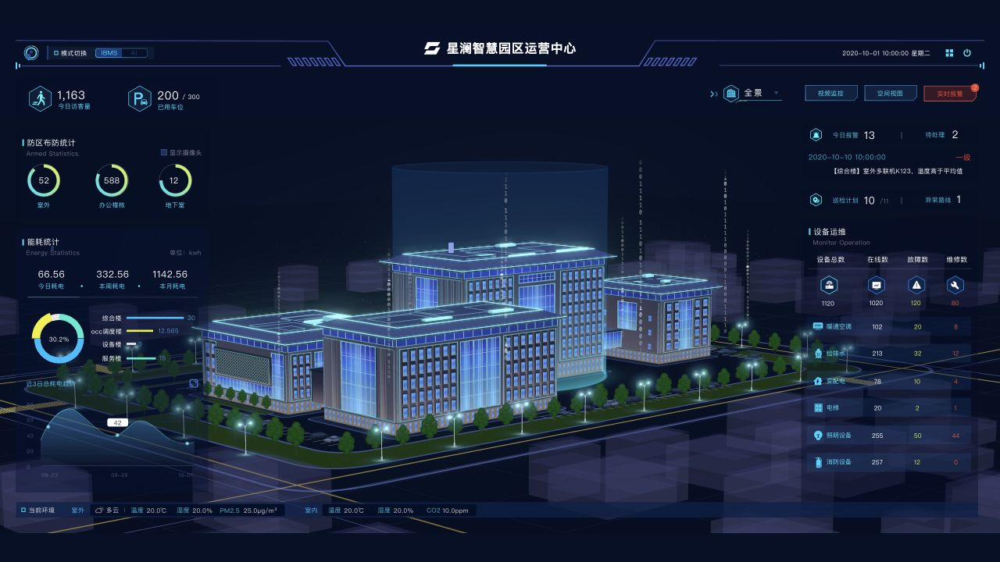
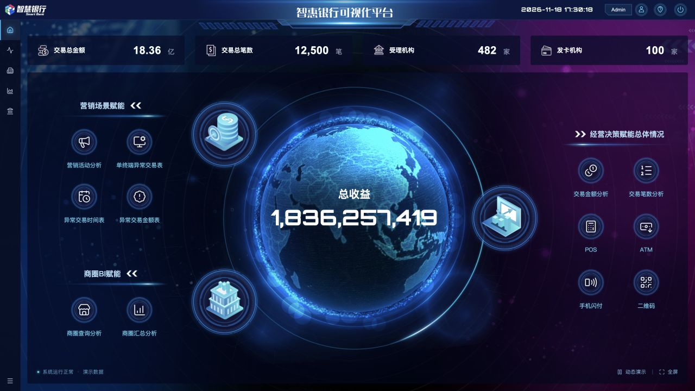
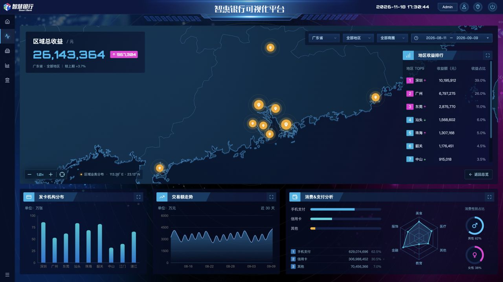
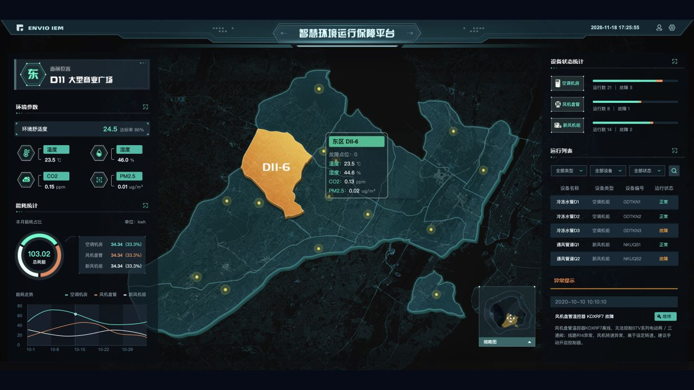
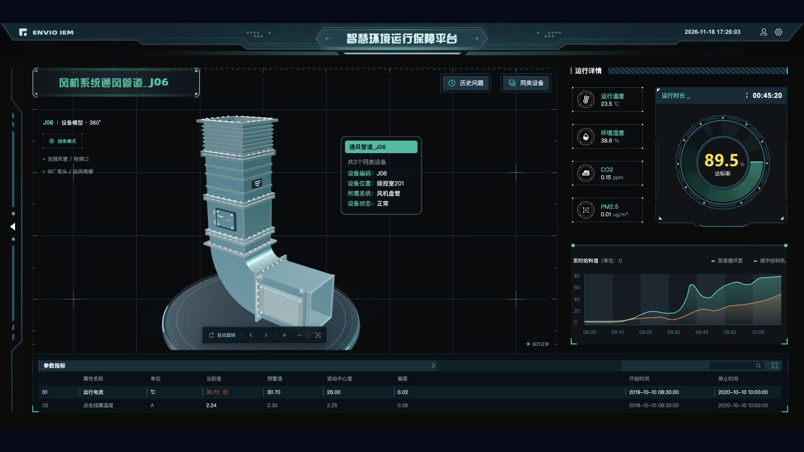

# 数据可视化-交互 Demo 还原 V1.0

*Data Visualization Design to Interactive Demo*

将数据可视化设计图或 GIF，还原成可交互、可继续修改的网页 Demo。对照原稿调整布局、图表与三维效果，并实现页面切换、数据筛选、点击弹窗等交互。

目前已测试数据看板、科技地球、智慧园区、环境监测等可视化项目。其他类型的设计稿尚未验证。

### 还原效果

以下为 Demo 的实际运行截图。图中数据为演示数据。

#### 智慧城市

**首页**：展示三维园区、楼宇轮廓光、访客与停车统计、能耗趋势、实时报警和设备运维信息。

[查看项目作品集](https://www.lipdrawer.cn/works/)

#### 科技地球

**主页**：展示可旋转的三维地球、交易概览与业务模块，点击地球进入区域详情。

**区域详情**：展示区域地图、地区收益排行、发卡机构分布、交易额走势及消费与支付分析，支持按区域筛选。

[打开科技地球 Demo](https://www.lipdrawer.cn/works/demos/finance/) · [查看全部项目](https://www.lipdrawer.cn/works/)

#### 智慧环境

**环境总览**：查看分区地图、环境参数、能耗趋势与设备运行状态，并从运行列表进入设备详情。

**设备详情**：查看通风管道三维模型、运行指标与参数，支持旋转、缩放和切换线条模型。

[打开智慧环境 Demo](https://www.lipdrawer.cn/works/demos/environment/) · [查看全部项目](https://www.lipdrawer.cn/works/)

**选一种用法就能开始。** 第一次试用，推荐直接复制。经常使用且 AI 工具有自定义技能入口，可以安装一次后反复调用。

### 用法一 · 直接复制

1. 打开[可复制正文.txt](./可复制正文.txt)，用文件页的复制按钮复制全文，或点 **Raw** 后全选复制。
2. 在能接收图片的 AI 工具里新建对话，把全文粘贴到输入框，先留在输入框里。
3. 在同一条消息里附上数据可视化设计图或 GIF，然后发送。全文里已经包含制作任务。
4. 打开 AI 回复里的试玩入口，或按回复里的方法打开网页文件。需要修改时在原对话里继续说明。

### 用法二 · 安装 Skill

1. 打开[数据可视化-交互 Demo 还原-V1.0-Skill.zip](<./数据可视化-交互 Demo 还原-V1.0-Skill.zip>)，在文件页点击下载按钮保存安装包。
2. 在 AI 工具的「技能 / Skills」管理中选择「导入」或「上传自定义技能」，选刚下载的 ZIP 并启用。若工具要求选文件夹，先解压 ZIP，选择里面含有 `SKILL.md` 的 `dashboard-design-to-demo` 文件夹。
3. 新建 AI 对话。有技能选择器时选 `dashboard-design-to-demo`，然后把数据可视化设计图或 GIF 作为附件上传。
4. 图片附好后，输入下面这句话并发送。以后换图从第 3 步开始。

   > 请使用 dashboard-design-to-demo（数据可视化-交互 Demo 还原），把这张数据可视化设计图做成可交互的网页 Demo。请对照原图自查，并提供试玩入口和同机位对比图。

5. 打开 AI 回复里的试玩入口，或按回复里的方法打开网页文件。

### 可以期待什么

能完成并走查通过时，直接交完整 Demo、可编辑源码和同机位实拍。原尺寸核对两三处最能认出这张稿的细节，三维主体再查侧面、背面、缩放和复位。多稿共用一个试玩入口，逐张点开验证。

你可以指定先做哪张。没有指定时，AI 先做较快能完成、又能代表需求的一张。固定构图会在原稿和预览窗口两种尺寸下核对边界与图片，立体主体会试「放大、缩到能看全、复位」。

遇到长时间精调，先给你能打开的版本。同一处连续两轮都没改善时，AI 停在这张等你选。你可以回「继续修这里」「先做另一张」或「暂停项目」。你也可随时主动暂停，保存交付的版本和续做指令，回来从原进度接着做。已看出问题的地方写「待修」，无法实际检查的写「待验证」。只能写代码的环境会给出可保存的代码和打开方法。

单图未展示的结构按可见线索合理延展。若另一角度有特别设计，可在原对话里补图精调。安装包附材质、对稿、离线交接细则和可选的本地检查工具。普通用户按上面任一条用法即可。

喜欢用按钮一步步操作，可以下载仓库文件，解压后用浏览器打开 `使用说明.html`。开发者也可以直接查看[技能源文件](./dashboard-design-to-demo/SKILL.md)。

### 自愿打赏

如果这个 Skill 对你有帮助，欢迎请我喝杯咖啡 ☕

完全自愿，不打赏也可以正常使用。谢谢支持！

展开微信收款码

